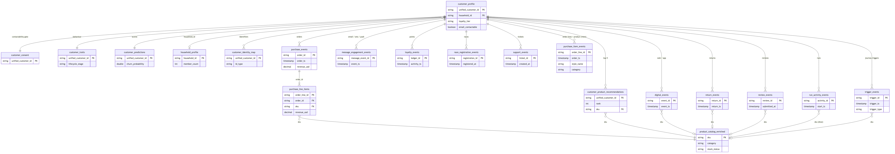
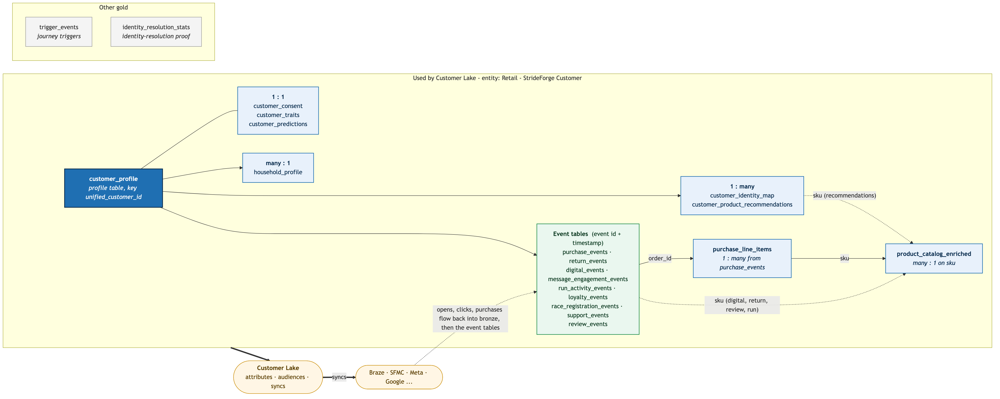

# StrideForge CDP demo (Databricks)

Synthetic, story-driven Customer Data Platform demo for **StrideForge**, a fictitious global sportswear brand
(1.5M customers, US / UK / DE / CA, Oct 2023 – Oct 2026), built as a medallion lakehouse in Unity Catalog and
packaged as a Declarative Automation Bundle (DAB) so it can be redeployed to any workspace.

## What gets built

| Layer | Schema (default) | Contents |
|---|---|---|
| Bronze | `retail_bronze` | 42 raw source tables (POS, e-com, app, web clickstream, loyalty, run app, ESP, consent, paid media, affiliates, service, reviews, PIM, inventory, weather, ...) ~274M rows |
| Silver | `retail_silver` | 37 conformed tables incl. identity resolution (`customer_source_records` → `identity_match_pairs` → `identity_graph` → `customers`) |
| Gold | `retail_gold` | 21 tables: Customer 360, traits, predictions, recommendations, segments, triggers, exports, campaign measurement. Tables with `TBLPROPERTIES ('cdp_activation' = 'true')` are the activation contract for the CDP |
| Truth | `retail_synthetic_truth` | Generator scratch tables + identity answer key (used to score identity resolution) |

### Business stories baked into the data
1. Fragmented identity: ~3.4M source profiles for 1.5M real people.
2. CloudStride 3 (launched 2026-03-05) runs half a size small: online return rate ~43%, "too small" reviews, sizing-ticket backlog; size guidance on 2026-07-15 brings returns back to ~19%.
3. Run-app shoe mileage: runners who pass 400+ miles without replacing lapse or switch brands.
4. Black Friday 2025 over-mailing: weekly unsubscribes jump from ~330 to ~11K.
5. Reseller bot clusters on limited drops (shared addresses, 100+ accounts).
6. Seasonality (Jan / Aug / BF–Dec), ~8% YoY growth, rainy autumn 2025 in the Pacific NW and UK.

## Gold data model



Activation flow (Customer 360 → audiences → destinations → measurement):



Mermaid sources: `docs/gold_er.mmd`, `docs/gold_data_model.mmd`.

## Repository layout

Every job task is a **Databricks notebook** (source-format `.py`) with widgets for `catalog`, `bronze`, `silver`,
`gold`, `truth` (populated from job `base_parameters`, so each notebook can also be opened and run interactively).
Shared widgets and the `run()` helper live in `src/_params.py` (included with `%run ../_params`); SQL notebooks run one
statement per cell through `run()`, which substitutes the schema names.

```
databricks.yml                         bundle + variables + targets
resources/
  strideforge_bronze_setup.job.yml     DDL -> synthetic bronze generation -> story validation
  strideforge_medallion.job.yml        bronze -> silver -> gold (16 serverless notebook tasks)
src/
  ddl/          01_bronze, 02_silver, 03_gold            table contracts (comments, PKs, cdp_activation tags)
  generator/    generate_bronze, validate_bronze         notebooks; gen/ = generator library (Spark + Faker)
  silver/       00_functions .. 08_customer_enrichment   incl. 02_identity_resolution, 07b_ai_enrichment
  gold/         01_customer_360 .. 04_measurement        incl. 03_audiences (segments, triggers, exports)
docs/           gold data model diagrams
```

## Medallion job DAG

```
ensure_tables -> silver_functions -> silver_reference -> silver_identity_resolution      (ensure_gold_tables runs in parallel)
  silver_identity_resolution -> silver_commerce -> silver_service -> silver_ai_review_enrichment
                             -> silver_commerce -> silver_customer_enrichment
                             -> silver_behavior -> silver_marketing (also needs commerce)
                             -> silver_loyalty_sport
  {ensure_gold_tables, customer_enrichment, marketing, loyalty_sport, ai_review_enrichment} -> gold_customer_360
  gold_customer_360 -> gold_predictions_products -> gold_audiences
  gold_customer_360 -> gold_measurement
```

Identity resolution: deterministic keys (normalized email, E.164 phone, loyalty id, POS card scans, run-app order
references) plus probabilistic keys (canonical first name + last name + postal code / birth date), hub keys
(>25 records) excluded, connected components via min-label propagation with pointer jumping. Results are scored
against the synthetic answer key in `retail_synthetic_truth.identity_resolution_eval`.

`customer_predictions` uses a transparent `heuristic_v1` scoring baseline (churn, CLV, replacement date, drop hype,
reseller risk, ...) so the whole flow runs without model training; swap in MLflow models as a next step.
`silver_ai_review_enrichment` upgrades the 20K most recent reviews with `ai_analyze_sentiment` / `ai_classify`.

## Deploy / run

Requires the Databricks CLI (bundles) and a workspace with Unity Catalog + serverless jobs.

```bash
# this workspace (dev target)
databricks bundle deploy
databricks bundle run strideforge_medallion            # bronze already populated here

# a new workspace: create the catalog first, then
databricks bundle deploy -t prod --profile <other> --var catalog=<catalog>
databricks bundle run strideforge_bronze_setup -t prod --profile <other> --var catalog=<catalog>   # ~20-40 min at scale 1.0
databricks bundle run strideforge_medallion   -t prod --profile <other> --var catalog=<catalog>
```

Use `--var scale=0.01` for a quick smoke test (15K customers). `src/generator/run.py` runs the same generator locally
through Databricks Connect (`SF_SCALE=0.01 python run.py`). All schema names are bundle variables
(`bronze_schema`, `silver_schema`, `gold_schema`, `truth_schema`).
