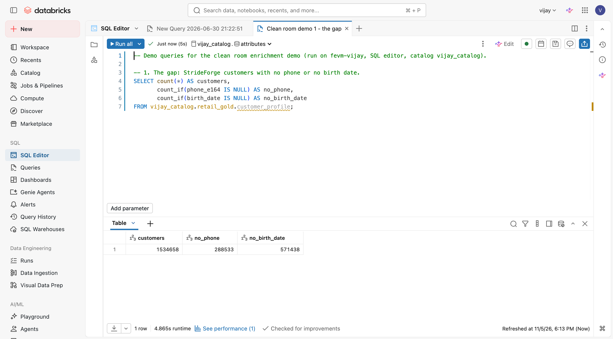
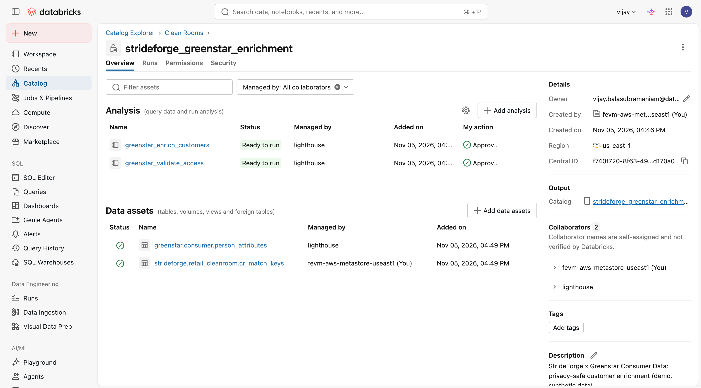
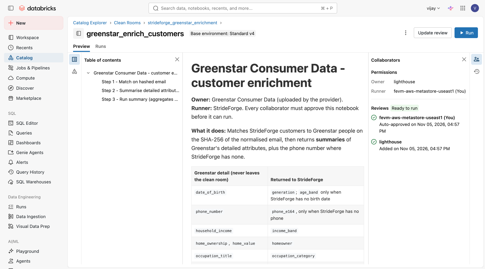
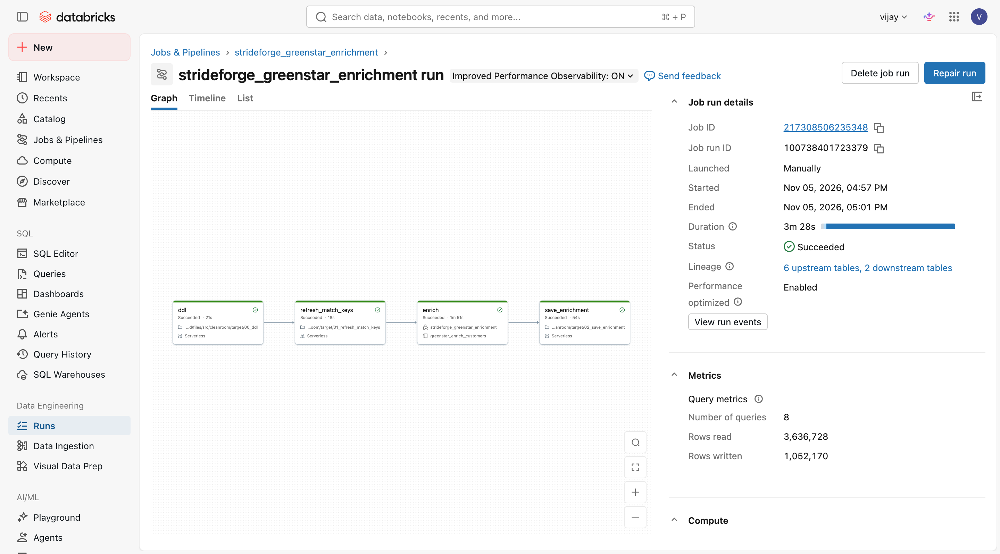
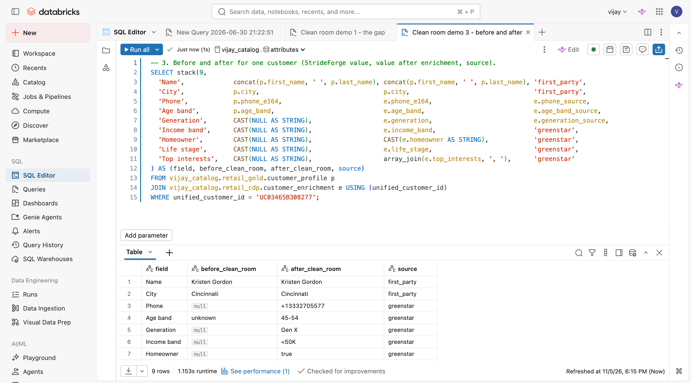
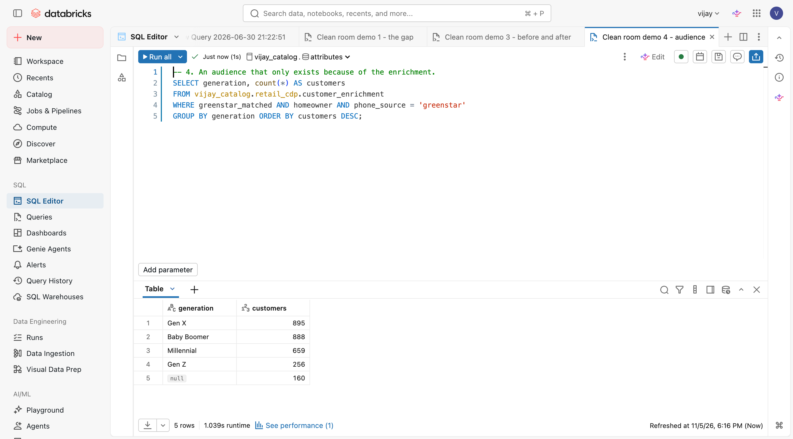

# Demo script: privacy-safe customer enrichment with Databricks Clean Rooms

**Length:** under 5 minutes, 4 steps. **Audience:** marketing and data leads.
**Setup:** [DESIGN.md section 12](../DESIGN.md#12-module-clean-room-enrichment-greenstar-consumer-data).
Queries: [`src/cleanroom/sql/demo_queries.sql`](../src/cleanroom/sql/demo_queries.sql).

**Story.** StrideForge, a running and outdoor retailer, wants to know its customers better. Greenstar Consumer Data,
a consumer data provider, has detailed data on millions of people. Neither side can hand its data to the other.
A Databricks Clean Room lets Greenstar's approved code run on both datasets, and StrideForge gets back only the
summaries it licensed.

**Before you start (2 minutes):** open the `fevm-vijay` workspace (on VPN). Have three tabs ready: Catalog →
Clean Rooms → `strideforge_greenstar_enrichment`; a SQL editor with `demo_queries.sql`; and Customer Lake. Run the
`strideforge_greenstar_enrichment` job once beforehand (about 4 minutes) so the results are fresh.

---

## Step 1 – The gap (45 seconds)

**Show:** SQL editor, query 1.

**Say:** "StrideForge has 1.5 million identity-resolved customers. About 290,000 have no phone number and 570,000
have no birth date, so we can't text them or target by generation. A consumer data provider can fill those gaps, but
legal won't let us send them our customer list, and they won't send us their raw file."

## Step 2 – The clean room (75 seconds)

**Show:** Catalog → Clean Rooms → `strideforge_greenstar_enrichment` → **Overview**, then the **Assets** list.

**Say:** "This clean room connects two separate Databricks accounts. StrideForge shares one table: a hashed email,
country and two yes/no flags, 'do we have a phone' and 'do we have a birth date', and only for customers who allow
profiling. No names, no raw emails. Greenstar shares its consumer file. Neither of us can query the other's table.
The only thing that can touch both is code that we've both approved, running on serverless compute with no internet
access."

*If asked "can Greenstar see our customers?":* "No. Greenstar can't run anything here. The results go only to
StrideForge's catalog, and Greenstar never learns who matched."

## Step 3 – The provider's notebook: detail in, summaries out (90 seconds)

**Show:** the notebook `greenstar_enrich_customers` (approved), scroll to the table at the top, then the job run.

**Say:** "Greenstar wrote this notebook, so Greenstar controls what leaves the room. It has each person's exact date
of birth, but we only get the **generation**: Gen Z, Millennial, Gen X, Boomer. Exact income becomes an **income
band**, the occupation title becomes a **category**, and 20 interest scores become the **top three interests**.
The one raw value we get is the **phone number**, and only where we don't already have one. Every version of this
notebook needs approval before it can run. A scheduled job refreshes our keys, runs the notebook in the clean room
and saves the output, in about four minutes."

*If asked about approval:* "Any change to the code creates a new version that has to be approved again. Here an
auto-approval rule covers Greenstar's notebooks that only StrideForge runs, because the output only comes to us."

## Step 4 – The result in Customer Lake (75 seconds)

**Show:** SQL editor, queries 3 and 4 (or the same audience in Customer Lake).

**Say:** "Here's Kristen in Cincinnati. Before, no phone and age 'unknown'. Now she has a phone, from Greenstar,
she's Gen X, 45 to 54, a homeowner, and her top interest is running. Each value has a source column, so we always know
what's first-party and what's licensed, and our own data always wins. This shows up in Customer Lake as one more
1:1 table on the customer entity, so marketing can build an audience like 'homeowners whose phone came from
Greenstar', about 2,900 people we can now reach by SMS, split by generation."

**Close:** "Two companies, no data copied between them, only the summaries that were licensed, and the whole thing
is governed in Unity Catalog and runs on a schedule."

---

### Numbers to quote (first run)

| | |
|---|---|
| StrideForge customers shared (hashed, consented) | 1,032,170 |
| Greenstar file | 50,000 people |
| Matched | 20,000 |
| Phone added | 6,090 |
| Age band and generation added | 11,829 |
| Generation conflicts (first-party kept) | 36 |
| Job run time | about 4 minutes |
